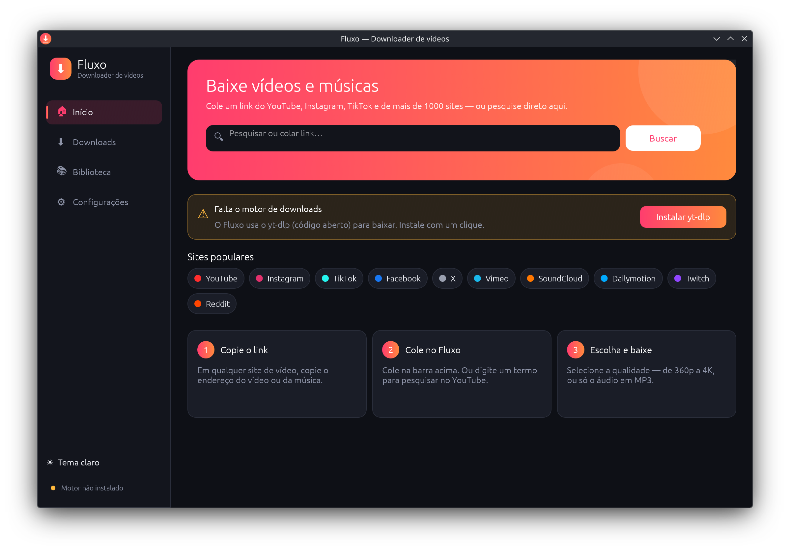
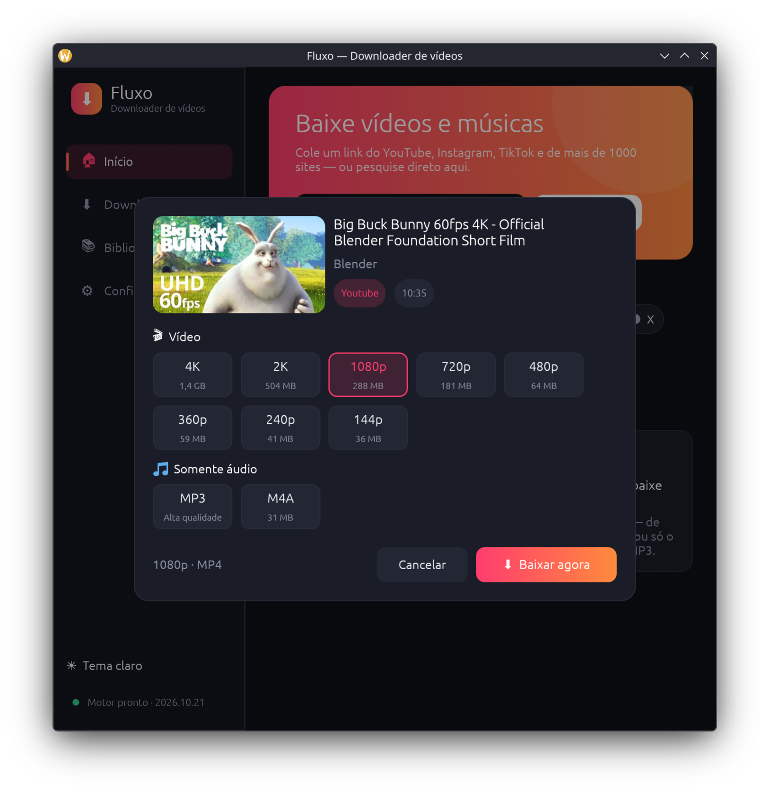
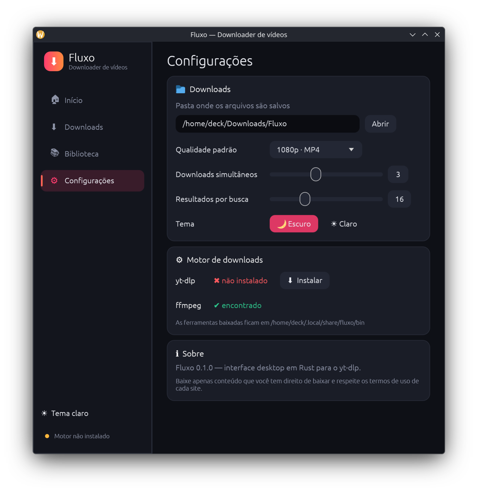

<p align="center"></p>

# Fluxo

Downloader de vídeos e músicas para Linux e Windows, escrito em Rust com [egui](https://github.com/emilk/egui).
Inspirado nas funcionalidades do SnapTube (busca, escolha de qualidade, fila de downloads, biblioteca), com código, nome e visual próprios.
Os downloads são feitos pelo [yt-dlp](https://github.com/yt-dlp/yt-dlp), e o ffmpeg cuida de mesclar e converter.



| Escolha de qualidade | Configurações |
| --- | --- |
|  |  |

## Download

Baixe a versão mais recente na página de [Releases](../../releases/latest):

- **Windows 10/11:** `Fluxo-windows-x86_64.exe` — é só abrir.
- **Linux x86_64:** `fluxo-linux-x86_64.tar.gz` — extraia e rode `./install.sh` para ganhar o atalho no menu (ou rode `./fluxo` direto). Precisa de glibc 2.43 ou mais nova.

Na primeira vez, clique em **Instalar yt-dlp** (e, se quiser 1080p+ e MP3, em **Instalar ffmpeg** nas Configurações). O Fluxo baixa as versões oficiais do GitHub.

## Funcionalidades

- Busca no YouTube ou colagem de links de mais de 1000 sites
- Escolha de qualidade (144p a 8K, de acordo com o que o vídeo oferece), ou somente áudio em MP3/M4A
- Fila de downloads com progresso, velocidade, tempo restante, cancelar e tentar novamente
- Biblioteca com o histórico, filtro e atalhos para abrir o arquivo ou a pasta
- Instalação e atualização do yt-dlp e do ffmpeg com um clique
- Tema escuro e claro, downloads simultâneos configuráveis
- `fluxo URL` abre direto a escolha de qualidade do link, `fluxo "termo"` já pesquisa, e `--page downloads|library|settings` abre direto numa tela

## Compilar

Linux (precisa de um compilador C/linker, ex.: `gcc`):

```bash
cargo build --release
```

Windows, compilando a partir do Linux (precisa do `mingw-w64-gcc`):

```bash
rustup target add x86_64-pc-windows-gnu
CARGO_TARGET_X86_64_PC_WINDOWS_GNU_LINKER=x86_64-w64-mingw32-gcc cargo build --release --target x86_64-pc-windows-gnu
```

No próprio Windows basta `cargo build --release`.

O binário Linux exige uma glibc igual ou mais nova que a da máquina onde foi ligado; para distribuir para distros mais antigas, compile numa distro mais antiga.

Testes de rede (rodam o yt-dlp de verdade: busca, metadados, download MP4 e MP3):

```bash
cargo test --release -- --ignored --test-threads=1
```

## Onde ficam os dados

- Configurações, histórico e ferramentas baixadas: `~/.local/share/fluxo` (Linux) ou `%APPDATA%\Fluxo\Fluxo\data` (Windows)
- Downloads: `~/Downloads/Fluxo` por padrão (dá para mudar em Configurações)

Baixe apenas conteúdo que você tem direito de baixar e respeite os termos de uso de cada site.
