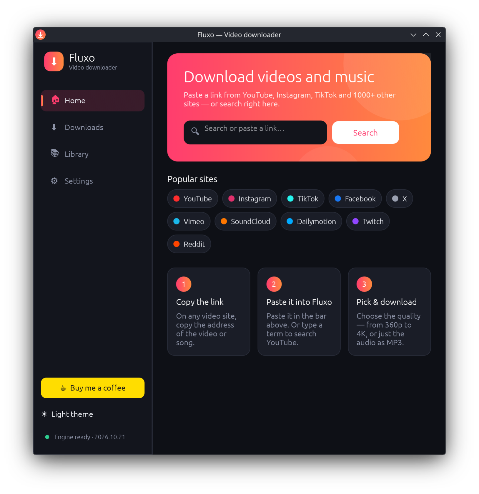
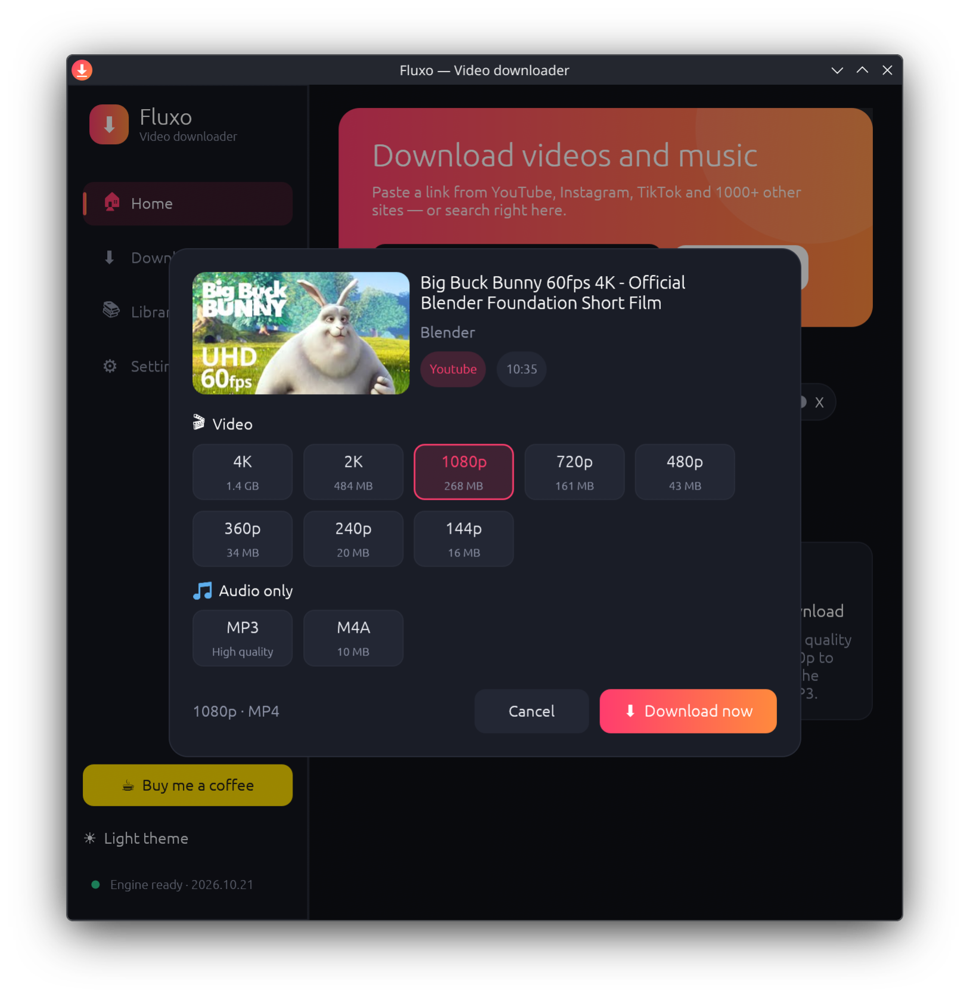
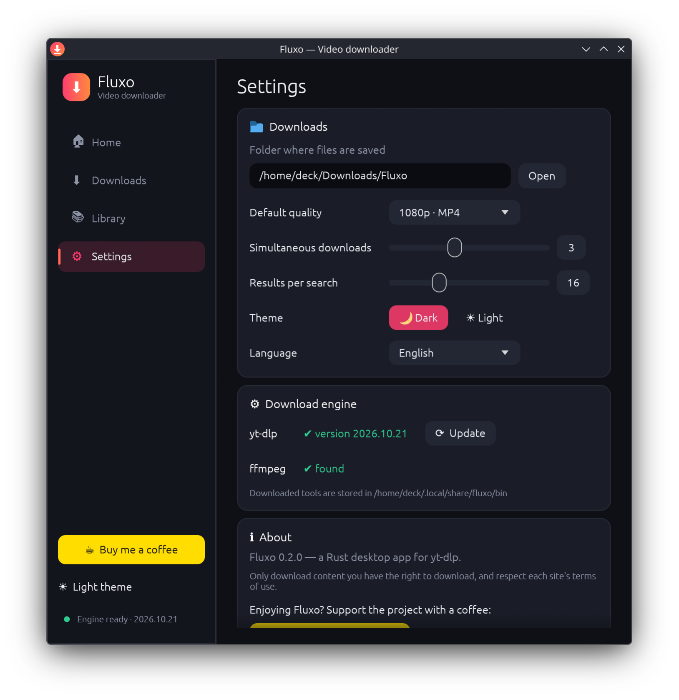

<p align="center"></p>

# Fluxo

[](https://buymeacoffee.com/kromossomoc)

**English** · [Português](README.pt-BR.md)

A video and music downloader for Linux and Windows, written in Rust with [egui](https://github.com/emilk/egui).
Inspired by SnapTube's features (search, quality picker, download queue, library), with its own code, name and look.
Downloads are handled by [yt-dlp](https://github.com/yt-dlp/yt-dlp), and ffmpeg takes care of merging and converting.



| Quality picker | Settings |
| --- | --- |
|  |  |

## Download

Get the latest version from the [Releases](../../releases/latest) page:

- **Windows 10/11:** `Fluxo-windows-x86_64.exe` — just run it.
- **Linux x86_64:** `fluxo-linux-x86_64.tar.gz` — extract it and run `./install.sh` to get a menu shortcut (or run `./fluxo` directly). Requires glibc 2.43 or newer.

On first launch, click **Install yt-dlp** (and, for 1080p+ and MP3, **Install ffmpeg** in Settings). Fluxo downloads the official builds from GitHub.

## Features

- Search YouTube or paste links from 1000+ sites
- Pick the quality (144p up to 8K, depending on the video) or audio only as MP3/M4A
- Download queue with progress, speed, time left, cancel and retry
- Library with history, filter and shortcuts to open the file or its folder
- One-click install and update of yt-dlp and ffmpeg
- English and Portuguese interface (follows the system language, or pick one in Settings)
- Dark and light themes, configurable simultaneous downloads
- `fluxo URL` opens the quality picker for that link, `fluxo "term"` searches right away, and `--page downloads|library|settings` opens a specific screen

## Building

Linux (needs a C compiler/linker, e.g. `gcc`):

```bash
cargo build --release
```

Windows, cross-compiling from Linux (needs `mingw-w64-gcc`):

```bash
rustup target add x86_64-pc-windows-gnu
CARGO_TARGET_X86_64_PC_WINDOWS_GNU_LINKER=x86_64-w64-mingw32-gcc cargo build --release --target x86_64-pc-windows-gnu
```

On Windows itself, `cargo build --release` is enough.

The Linux binary requires a glibc at least as new as the one it was linked against; to support older distros, build on an older distro.

Network tests (they run the real yt-dlp: search, metadata, MP4 and MP3 downloads):

```bash
cargo test --release -- --ignored --test-threads=1
```

## Where data lives

- Settings, history and downloaded tools: `~/.local/share/fluxo` (Linux) or `%APPDATA%\Fluxo\Fluxo\data` (Windows)
- Downloads: `~/Downloads/Fluxo` by default (change it in Settings)

## Support

If Fluxo is useful to you, consider [buying me a coffee](https://buymeacoffee.com/kromossomoc) ☕

Only download content you have the right to download, and respect each site's terms of use.
